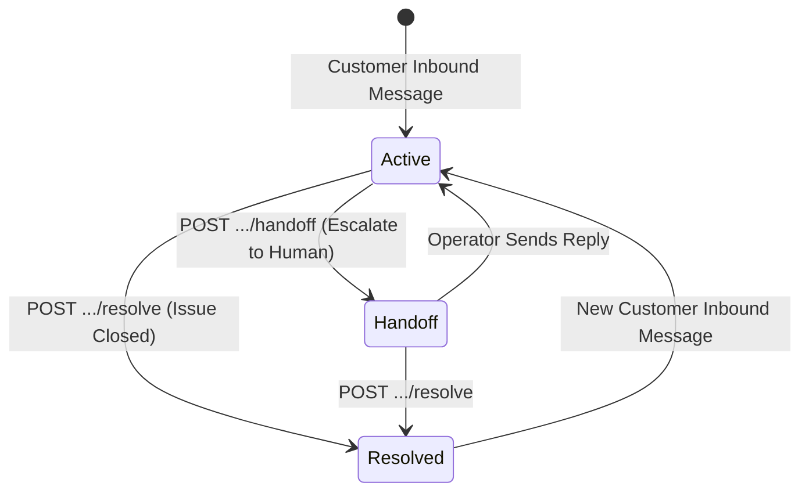

import { Callout } from "fumadocs-ui/components/callout";
import { Tab, Tabs } from "fumadocs-ui/components/tabs";

The Cerebronix Conversations API allows external software systems, help desks, CRM dashboards, and automated ticketing bots to programmatically query conversation histories, dispatch agent or operator replies, manage human escalation workflows, and resolve support threads.

All conversation routes are org-scoped and versioned under `https://public-api.cerebronix.com/v1/organizations/{organization_id}/conversations`.

---

## Conversation Lifecycle & State Transitions

Every conversation thread advances through a deterministic lifecycle state machine:



- **`active` (`open`):** The conversation is actively running. If bound to an AI agent, the agent automatically generates grounded replies to incoming messages.
- **`pending_human` (`handoff`):** The conversation has been escalated to a human supervisor (via the public API or internal agent tool call). Autonomous AI generation is paused until a human responds or the state is cleared.
- **`resolved`:** The issue is marked closed. If the customer sends another message in the future, the thread transitions back to `active`.

---

## Required Permissions & Scopes

| Endpoint | HTTP Method | Required Scope | Minimum Role |
| :--- | :--- | :--- | :--- |
| `/v1/organizations/{org_id}/conversations` | `GET` | `conversations:read` | `viewer` |
| `/v1/organizations/{org_id}/conversations/{id}` | `GET` | `conversations:read` | `viewer` |
| `/v1/organizations/{org_id}/conversations/{id}/messages` | `GET` | `conversations:read` | `viewer` |
| `/v1/organizations/{org_id}/conversations/{id}/messages` | `POST` | `conversations:write` | `developer` |
| `/v1/organizations/{org_id}/conversations/{id}/handoff` | `POST` | `conversations:write` | `developer` |
| `/v1/organizations/{org_id}/conversations/{id}/resolve` | `POST` | `conversations:write` | `developer` |
| `/v1/organizations/{org_id}/ws_tickets` | `POST` | `conversations:read` | `viewer` |

---

## 1. List Conversations

Retrieve a paginated list of conversations for your organization, with optional filtering by status and communication channel.

```http
GET https://public-api.cerebronix.com/v1/organizations/{organization_id}/conversations
```

### Query Parameters

| Parameter | Type | Default | Description |
| :--- | :--- | :--- | :--- |
| `status` | string | `all` | Filter by thread status: `open` or `resolved`. |
| `channel_id` | string | *None* | Filter conversations originating from a specific channel ID. |
| `limit` | integer | `25` | Number of records to return (1 to 100). |
| `cursor` | string | *None* | Opaque cursor string for pagination returned by `next_cursor`. |

<Tabs items={["cURL", "TypeScript", "Python"]}>
```bash tab="cURL"
curl -sS "https://public-api.cerebronix.com/v1/organizations/$ORG_ID/conversations?status=open&limit=25" \
  -H "Authorization: Bearer $ACCESS_TOKEN"
```

```typescript tab="TypeScript"
import axios from 'axios';

interface Conversation {
  id: string;
  channel_id: string;
  contact_id: string;
  agent_id: string;
  status: string;
  handoff_state: string;
  created_at: string;
  updated_at: string;
  last_message_preview?: string;
}

interface ListConversationsResponse {
  conversations: Conversation[];
  next_cursor?: string;
}

async function listOpenConversations(orgId: string, token: string): Promise<ListConversationsResponse> {
  const response = await axios.get<ListConversationsResponse>(
    `https://public-api.cerebronix.com/v1/organizations/${orgId}/conversations`,
    {
      params: { status: 'open', limit: 25 },
      headers: { Authorization: `Bearer ${token}` },
    }
  );
  return response.data;
}
```

```python tab="Python"
import requests

def list_conversations(org_id: str, token: str, status: str = "open", limit: int = 25):
    url = f"https://public-api.cerebronix.com/v1/organizations/{org_id}/conversations"
    headers = {"Authorization": f"Bearer {token}"}
    params = {"status": status, "limit": limit}
    
    response = requests.get(url, headers=headers, params=params)
    response.raise_for_status()
    return response.json()
```
</Tabs>

#### Response (`200 OK`)
```json
{
  "conversations": [
    {
      "id": "67123456789abcdef0123456",
      "channel_id": "670123456789abcdef012345",
      "contact_id": "670987654321fedcba098765",
      "agent_id": "6ac4d46c4dad9d577f47fa0e",
      "status": "open",
      "handoff_state": "none",
      "created_at": "2026-10-19T21:30:00Z",
      "updated_at": "2026-10-19T21:45:00Z",
      "last_message_preview": "I need help tracking my order #10842."
    }
  ],
  "next_cursor": "eyJpZCI6IjY3MTIzNDU2Nzg5YWJjZGVmMDEyMzQ1NiJ9"
}
```

---

## 2. Retrieve Conversation Details

Fetch full metadata for a specific conversation by ID.

```http
GET https://public-api.cerebronix.com/v1/organizations/{organization_id}/conversations/{id}
```

```bash
curl -sS "https://public-api.cerebronix.com/v1/organizations/$ORG_ID/conversations/$CONV_ID" \
  -H "Authorization: Bearer $ACCESS_TOKEN"
```

#### Response (`200 OK`)
```json
{
  "id": "67123456789abcdef0123456",
  "channel_id": "670123456789abcdef012345",
  "contact_id": "670987654321fedcba098765",
  "agent_id": "6ac4d46c4dad9d577f47fa0e",
  "status": "open",
  "handoff_state": "pending_human",
  "created_at": "2026-10-19T21:30:00Z",
  "updated_at": "2026-10-19T21:50:00Z",
  "last_message_preview": "Can I speak with a live representative?"
}
```

---

## 3. List Messages

Retrieve the chronological transcript of messages within a conversation thread.

```http
GET https://public-api.cerebronix.com/v1/organizations/{organization_id}/conversations/{id}/messages
```

```bash
curl -sS "https://public-api.cerebronix.com/v1/organizations/$ORG_ID/conversations/$CONV_ID/messages" \
  -H "Authorization: Bearer $ACCESS_TOKEN"
```

#### Response (`200 OK`)
```json
{
  "messages": [
    {
      "id": "msg_01923456789a",
      "conversation_id": "67123456789abcdef0123456",
      "direction": "incoming",
      "content": "Hello, when will order #10842 arrive?",
      "content_type": "text",
      "created_at": "2026-10-19T21:30:00Z",
      "actor_type": "contact"
    },
    {
      "id": "msg_01923456789b",
      "conversation_id": "67123456789abcdef0123456",
      "direction": "outgoing",
      "content": "Order #10842 was shipped via FedEx and is estimated for delivery tomorrow by 3:00 PM.",
      "content_type": "text",
      "created_at": "2026-10-19T21:30:05Z",
      "actor_type": "agent"
    }
  ]
}
```

---

## 4. Send Message (Operator / Outgoing)

Send an outgoing message into the conversation thread. This dispatches the message down the active channel (WhatsApp, Web Chat, Telegram) to the customer.

```http
POST https://public-api.cerebronix.com/v1/organizations/{organization_id}/conversations/{id}/messages
```

### Request Body
```json
{
  "content": "I have escalated this issue to our logistics team for priority review.",
  "content_type": "text"
}
```

<Tabs items={["cURL", "TypeScript", "Python"]}>
```bash tab="cURL"
curl -sS -X POST "https://public-api.cerebronix.com/v1/organizations/$ORG_ID/conversations/$CONV_ID/messages" \
  -H "Authorization: Bearer $ACCESS_TOKEN" \
  -H "Content-Type: application/json" \
  -d '{
    "content": "I have escalated this issue to our logistics team."
  }'
```

```typescript tab="TypeScript"
async function sendOperatorMessage(orgId: string, convId: string, content: string, token: string) {
  const response = await axios.post(
    `https://public-api.cerebronix.com/v1/organizations/${orgId}/conversations/${convId}/messages`,
    { content },
    {
      headers: {
        Authorization: `Bearer ${token}`,
        'Content-Type': 'application/json',
      },
    }
  );
  return response.data;
}
```

```python tab="Python"
def send_message(org_id: str, conv_id: str, content: str, token: str):
    url = f"https://public-api.cerebronix.com/v1/organizations/{org_id}/conversations/{conv_id}/messages"
    headers = {
        "Authorization": f"Bearer {token}",
        "Content-Type": "application/json"
    }
    payload = {"content": content}
    response = requests.post(url, headers=headers, json=payload)
    response.raise_for_status()
    return response.json()
```
</Tabs>

#### Response (`201 Created`)
```json
{
  "id": "msg_01923456789c",
  "conversation_id": "67123456789abcdef0123456",
  "direction": "outgoing",
  "content": "I have escalated this issue to our logistics team.",
  "content_type": "text",
  "created_at": "2026-10-19T21:52:00Z",
  "actor_type": "operator"
}
```

---

## 5. Operator Handoff (Escalation)

Escalate a conversation from an automated AI agent to a human operator. This updates the thread status to `pending_human`, alerts human agents in the Operator Inbox, and pauses autonomous AI replies.

```http
POST https://public-api.cerebronix.com/v1/organizations/{organization_id}/conversations/{id}/handoff
```

### Request Body
```json
{
  "reason": "Customer requested human supervisor for refund negotiation"
}
```

```bash
curl -sS -X POST "https://public-api.cerebronix.com/v1/organizations/$ORG_ID/conversations/$CONV_ID/handoff" \
  -H "Authorization: Bearer $ACCESS_TOKEN" \
  -H "Content-Type: application/json" \
  -d '{"reason": "Customer requested specialist consultation"}'
```

#### Response (`200 OK`)
```json
{
  "id": "67123456789abcdef0123456",
  "status": "open",
  "handoff_state": "pending_human",
  "updated_at": "2026-10-19T21:55:00Z"
}
```

---

## 6. Resolve Conversation

Mark an inquiry as resolved. This closes the active thread in the console and calculates resolution metrics.

```http
POST https://public-api.cerebronix.com/v1/organizations/{organization_id}/conversations/{id}/resolve
```

```bash
curl -sS -X POST "https://public-api.cerebronix.com/v1/organizations/$ORG_ID/conversations/$CONV_ID/resolve" \
  -H "Authorization: Bearer $ACCESS_TOKEN"
```

#### Response (`200 OK`)
```json
{
  "id": "67123456789abcdef0123456",
  "status": "resolved",
  "handoff_state": "resolved",
  "updated_at": "2026-10-19T22:00:00Z"
}
```

---

## 7. Mint Operator WebSocket Ticket

To stream live conversation events directly into an external operator console without polling, mint an operator WebSocket ticket:

```http
POST https://public-api.cerebronix.com/v1/organizations/{organization_id}/ws_tickets
```

```bash
curl -sS -X POST "https://public-api.cerebronix.com/v1/organizations/$ORG_ID/ws_tickets" \
  -H "Authorization: Bearer $ACCESS_TOKEN"
```

#### Response (`200 OK`)
```json
{
  "ticket": "eyJhbGciOiJSUzI1NiIsImtpZCI6IjY5YTY4NTV...",
  "expires_in": 120
}
```

Use this single-use ticket to establish a WebSocket connection to `wss://public-api.cerebronix.com/v1/ws/operator?ticket=<ticket>`. See the [WebSockets Guide](/docs/current/webhooks-and-websockets#operator-websocket-api) for message framing specifications.

---

## Error Handling & Status Codes

| Status Code | Error Code | Root Cause |
| :--- | :--- | :--- |
| **`400 Bad Request`** | `invalid_request` | The request body is empty, malformed, or missing required fields (`content`). |
| **`401 Unauthorized`** | `missing_actor` | Missing or expired Bearer token. |
| **`403 Forbidden`** | `missing_scope` | Token lacks `conversations:read` or `conversations:write`. |
| **`403 Forbidden`** | `insufficient_role` | Attempted a write operation (`messages`, `handoff`, `resolve`) with role `viewer`. |
| **`403 Forbidden`** | `org_mismatch` | Path parameter `{organization_id}` does not match the token's authorized organization. |
| **`404 Not Found`** | `not_found` | The specified conversation ID does not exist within this organization. |
| **`503 Service Unavailable`** | `unavailable` | Downstream messaging provider or chat gateway temporarily unreachable. |
