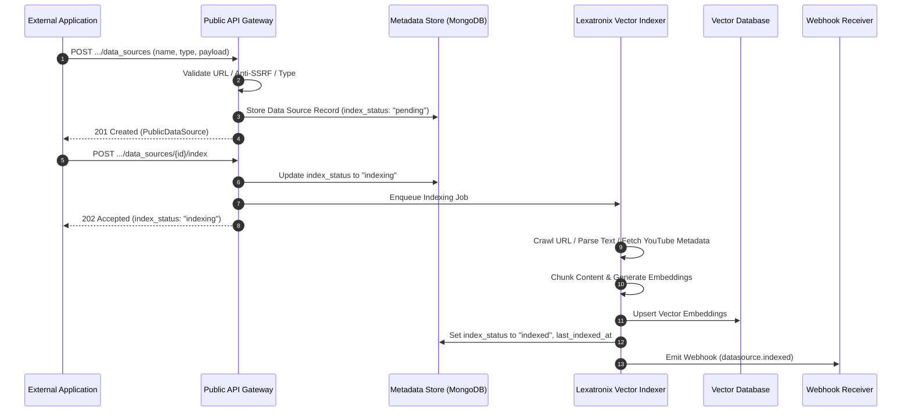

import { Callout } from "fumadocs-ui/components/callout";
import { Tab, Tabs } from "fumadocs-ui/components/tabs";

The Cerebronix Knowledge Engine allows organizations to inject proprietary knowledge, website documentation, FAQ repositories, and media transcripts into autonomous agents. Once a data source is created and indexed, the Lexatronix AI Orchestrator chunks the content, computes vector embeddings, and performs semantic similarity retrieval during conversational turns and direct `ask_agent` inference.

All knowledge endpoints are organization-scoped, strictly isolated by tenant, and hosted under `https://public-api.cerebronix.com/v1/organizations/{organization_id}/data_sources`.

---

## Knowledge Ingestion & Indexing Lifecycle

The Knowledge Engine processes data asynchronously to maintain platform responsiveness and vector consistency:



---

## Supported Public Data Source Types & Architectural Boundaries

The Public REST API provides a focused, deterministic subset of data-source types optimized for programmatic ingestion.

### 1. Supported Public REST Types

| Type (`type`) | Description | Required Parameters | Validation & Constraints |
| :--- | :--- | :--- | :--- |
| **`freetext`** | Raw text bodies, FAQs, policy documents, or knowledge snippets. | `text` (`string`) | Must not be empty or whitespace-only. Ideal for pushing CMS articles or markdown strings. |
| **`website`** | Public website or documentation URL for web crawler indexing. | `url` (`string`) | Must be a valid `http://` or `https://` URI. Anti-SSRF filters block private subnets, `localhost`, and cloud metadata IPs. |
| **`youtube`** | Public YouTube channel metadata and transcripts. | `youtube_channel_id` (`string`) or `url` (`string`) | YouTube channel ID (e.g., `UC...`) or public channel URL. Ingests published channel video titles, descriptions, and transcripts via Google YouTube API. |

---

### 2. Architectural Boundaries & Non-Public Connectors

Cerebronix differentiates between **programmatic public API ingestion** and **console-managed third-party integrations**:

<Callout type="warn">
  **Video Files vs. Public YouTube Channel Ingestion:**
  - **YouTube Transcripts (`type: "youtube"`):** Programmatically supported via the Public REST API by specifying `youtube_channel_id` (or public channel URL). The backend discovers public videos and imports their published transcripts.
  - **Direct Video File Uploads (MP4, MOV, AVI) & Private Video Assets:** **Not supported via the Public REST API**. Direct binary video uploading, file transcoding, and local Whisper transcription are managed strictly through the authenticated Cerebronix SaaS Web Console. Submitting binary video files to the public REST endpoints will result in validation failures.
</Callout>

<Callout type="warn">
  **Third-Party Cloud Connectors (Google Drive, SharePoint, Notion, Shopify):**
  OAuth-based cloud connectors require interactive user delegation, token refresh sequences, and webhook callbacks. These connectors are managed exclusively via the **Cerebronix SaaS Console UI**.
  Submitting unsupported connector types (e.g., `type: "shopify"`, `type: "googledrive"`, `type: "sharepoint"`) to the Public REST API returns HTTP `400 Bad Request` (`{"error": "invalid_request"}`).
</Callout>

---

## Required Permissions & Plan Entitlements

| Endpoint | HTTP Method | Required Scope | Minimum Role | Verification Level |
| :--- | :--- | :--- | :--- | :--- |
| `/v1/organizations/{org_id}/data_sources` | `GET` | `datasources:read` | `viewer` | `[Runtime-Tested]` |
| `/v1/organizations/{org_id}/data_sources/{id}` | `GET` | `datasources:read` | `viewer` | `[Code-Verified]` |
| `/v1/organizations/{org_id}/data_sources` | `POST` | `datasources:write` | `developer` | `[Contract-Tested]` |
| `/v1/organizations/{org_id}/data_sources/{id}` | `PATCH` | `datasources:write` | `developer` | `[Contract-Tested]` |
| `/v1/organizations/{org_id}/data_sources/{id}` | `DELETE` | `datasources:write` | `developer` | `[Contract-Tested]` |
| `/v1/organizations/{org_id}/data_sources/{id}/index` | `POST` | `datasources:write` | `developer` | `[Contract-Tested]` |

<Callout type="info">
  **Data Source Quotas:** Every subscription tier enforces a maximum number of active data sources:
  - **Growth Plan:** Up to **5** data sources.
  - **Scale Plan:** Up to **25** data sources.
  - **Enterprise Plan:** Custom quotas configured per organization contract.
  Exceeding the quota returns HTTP `403 Forbidden` (`{"error": "data_source_limit_exceeded"}`).
</Callout>

---

## Public Data Source Schema

The Public API returns a sanitized view of the data source record. Internal crawler configurations and storage parameters are intentionally omitted:

### Schema Properties

| Field | Type | Description |
| :--- | :--- | :--- |
| **`id`** | `string` | The unique hex-encoded identifier of the data source (`24-character hex`). |
| **`name`** | `string` | The display name of the data source. |
| **`description`** | `string` | Optional operational description. |
| **`type`** | `string` | The ingestion category: `freetext`, `website`, or `youtube`. |
| **`source_type`** | `string` | Internal storage provider classification (e.g., `service`). |
| **`index_status`** | `string` | Vector indexing state: `pending`, `indexing`, `indexed`, or `failed`. |
| **`last_indexed_at`** | `string` | ISO 8601 UTC timestamp of the last successful indexing run, or `null`. |

#### Example Data Source Representation
```json
{
  "id": "67123456789abcdef0123511",
  "name": "Developer API Documentation",
  "description": "Public developer guides and reference documentation",
  "type": "website",
  "source_type": "service",
  "index_status": "indexed",
  "last_indexed_at": "2026-10-19T22:30:00Z"
}
```

---

## 1. List Data Sources

Retrieve all configured knowledge data sources for the authenticated organization.

```http
GET https://public-api.cerebronix.com/v1/organizations/{organization_id}/data_sources
```

### Request Headers
- `Authorization: Bearer <ACCESS_TOKEN>` (requires scope `datasources:read`, minimum role `viewer`)

<Tabs items={["cURL", "TypeScript", "Python"]}>
```bash tab="cURL"
curl -sS "https://public-api.cerebronix.com/v1/organizations/$ORG_ID/data_sources" \
  -H "Authorization: Bearer $ACCESS_TOKEN"
```

```typescript tab="TypeScript"
import axios from 'axios';

async function listDataSources(orgId: string, token: string) {
  const response = await axios.get(
    `https://public-api.cerebronix.com/v1/organizations/${orgId}/data_sources`,
    {
      headers: { Authorization: `Bearer ${token}` }
    }
  );
  return response.data.data_sources;
}
```

```python tab="Python"
import requests

def list_data_sources(org_id: str, token: str):
    url = f"https://public-api.cerebronix.com/v1/organizations/{org_id}/data_sources"
    response = requests.get(url, headers={"Authorization": f"Bearer {token}"})
    response.raise_for_status()
    return response.json().get("data_sources", [])
```
</Tabs>

#### Response (`200 OK`)
```json
{
  "data_sources": [
    {
      "id": "67123456789abcdef0123511",
      "name": "Developer API Documentation",
      "description": "Public documentation",
      "type": "website",
      "source_type": "service",
      "index_status": "indexed",
      "last_indexed_at": "2026-10-19T22:30:00Z"
    },
    {
      "id": "67123456789abcdef0123522",
      "name": "Refund & Return Policy",
      "type": "freetext",
      "source_type": "service",
      "index_status": "pending",
      "last_indexed_at": null
    }
  ]
}
```

---

## 2. Create a Data Source

Create a new data source by providing type-specific configuration parameters.

```http
POST https://public-api.cerebronix.com/v1/organizations/{organization_id}/data_sources
```

### Request Headers
- `Authorization: Bearer <ACCESS_TOKEN>` (requires scope `datasources:write`, minimum role `developer`)
- `Content-Type: application/json`

---

### Example A: Free Text Data Source (`type: "freetext"`)

```json
{
  "name": "Internal Escalation Guidelines",
  "description": "Procedures for routing complex technical inquiries to senior engineers",
  "type": "freetext",
  "text": "# Escalation Policy\nIf a customer reports a 5xx error on the checkout endpoint, immediate escalation to on-call engineering is required via PagerDuty."
}
```

### Example B: Website Crawler (`type: "website"`)

```json
{
  "name": "Product Knowledge Base",
  "description": "Customer-facing help center articles",
  "type": "website",
  "url": "https://help.example.com"
}
```

<Callout type="warn">
  **Anti-SSRF Protection:** The `url` field is strictly validated. The server rejects non-routable hostnames (`localhost`, `127.0.0.1`), `.local` domains, and internal cloud metadata endpoints (`http://metadata.google.internal`, `169.254.169.254`). Violations return HTTP `400 Bad Request` (`{"error": "invalid_request"}`).
</Callout>

### Example C: YouTube Knowledge Source (`type: "youtube"`)

```json
{
  "name": "Developer Video Tutorials",
  "description": "Official YouTube channel tutorial transcripts",
  "type": "youtube",
  "youtube_channel_id": "UC_x5XG1OV2P6uZZ5FSM9Ttw"
}
```

<Tabs items={["cURL", "TypeScript", "Python"]}>
```bash tab="cURL"
curl -sS -X POST "https://public-api.cerebronix.com/v1/organizations/$ORG_ID/data_sources" \
  -H "Authorization: Bearer $ACCESS_TOKEN" \
  -H "Content-Type: application/json" \
  -d '{
    "name": "Product Knowledge Base",
    "type": "website",
    "url": "https://help.example.com"
  }'
```

```typescript tab="TypeScript"
async function createWebsiteSource(orgId: string, name: string, url: string, token: string) {
  const response = await axios.post(
    `https://public-api.cerebronix.com/v1/organizations/${orgId}/data_sources`,
    { name, type: 'website', url },
    {
      headers: {
        Authorization: `Bearer ${token}`,
        'Content-Type': 'application/json'
      }
    }
  );
  return response.data;
}
```

```python tab="Python"
def create_freetext_source(org_id: str, name: str, text_content: str, token: str):
    url = f"https://public-api.cerebronix.com/v1/organizations/{org_id}/data_sources"
    payload = {"name": name, "type": "freetext", "text": text_content}
    headers = {"Authorization": f"Bearer {token}", "Content-Type": "application/json"}
    response = requests.post(url, json=payload, headers=headers)
    response.raise_for_status()
    return response.json()
```
</Tabs>

#### Response (`201 Created`)
Records an audit event `datasource.created`.
```json
{
  "id": "67123456789abcdef0123533",
  "name": "Product Knowledge Base",
  "description": "",
  "type": "website",
  "source_type": "service",
  "index_status": "pending",
  "last_indexed_at": null
}
```

---

## 3. Retrieve Data Source Details

Fetch the current status and metadata of a single data source.

```http
GET https://public-api.cerebronix.com/v1/organizations/{organization_id}/data_sources/{data_source_id}
```

#### Response (`200 OK`)
```json
{
  "id": "67123456789abcdef0123533",
  "name": "Product Knowledge Base",
  "description": "",
  "type": "website",
  "source_type": "service",
  "index_status": "pending",
  "last_indexed_at": null
}
```

---

## 4. Update Data Source Content

Update the name, description, or underlying source content (`text`, `url`, or `youtube_channel_id`) of an existing data source.

```http
PATCH https://public-api.cerebronix.com/v1/organizations/{organization_id}/data_sources/{data_source_id}
```

### Request Body
```json
{
  "name": "Updated Knowledge Base",
  "url": "https://help.example.com/v2"
}
```

<Callout type="info">
  **Reindexing Required After Update:** Modifying a data source's content updates its configuration but does not automatically reindex vector embeddings. You must call the index endpoint (`POST .../index`) to update the vector database.
</Callout>

#### Response (`200 OK`)
Records an audit event `datasource.updated`.
```json
{
  "id": "67123456789abcdef0123533",
  "name": "Updated Knowledge Base",
  "type": "website",
  "source_type": "service",
  "index_status": "pending",
  "last_indexed_at": null
}
```

---

## 5. Trigger Data Source Indexing

Trigger asynchronous vector indexing for a data source. The indexer downloads content, chunks documents, generates dense vector embeddings, and updates the vector search index.

```http
POST https://public-api.cerebronix.com/v1/organizations/{organization_id}/data_sources/{data_source_id}/index
```

### Request Headers
- `Authorization: Bearer <ACCESS_TOKEN>` (requires scope `datasources:write`, minimum role `developer`)

<Tabs items={["cURL", "TypeScript", "Python"]}>
```bash tab="cURL"
curl -sS -X POST "https://public-api.cerebronix.com/v1/organizations/$ORG_ID/data_sources/$DS_ID/index" \
  -H "Authorization: Bearer $ACCESS_TOKEN"
```

```typescript tab="TypeScript"
async function triggerIndex(orgId: string, dataSourceId: string, token: string) {
  const response = await axios.post(
    `https://public-api.cerebronix.com/v1/organizations/${orgId}/data_sources/${dataSourceId}/index`,
    {},
    {
      headers: { Authorization: `Bearer ${token}` }
    }
  );
  return response.data; // { index_status: "indexing", ... }
}
```

```python tab="Python"
def trigger_index(org_id: str, data_source_id: str, token: str) -> dict:
    url = f"https://public-api.cerebronix.com/v1/organizations/{org_id}/data_sources/{data_source_id}/index"
    response = requests.post(url, headers={"Authorization": f"Bearer {token}"})
    response.raise_for_status()
    return response.json()
```
</Tabs>

#### Initial Response (`202 Accepted`)
The indexing job starts in the background:
```json
{
  "id": "67123456789abcdef0123533",
  "name": "Updated Knowledge Base",
  "type": "website",
  "source_type": "service",
  "index_status": "indexing",
  "last_indexed_at": null
}
```

#### Completion Webhook (`datasource.indexed`)
When vector generation completes, Cerebronix emits the `datasource.indexed` webhook:
```json
{
  "id": "evt_01923456789d",
  "type": "datasource.indexed",
  "created_at": "2026-10-19T22:32:00Z",
  "organization_id": "67123456789abcdef0123456",
  "data": {
    "data_source_id": "67123456789abcdef0123533"
  }
}
```

---

## 6. Delete Data Source

Permanently remove a data source. This operation purges associated vector embeddings from the vector index and removes the record from the database.

```http
DELETE https://public-api.cerebronix.com/v1/organizations/{organization_id}/data_sources/{data_source_id}
```

<Callout type="warn">
  **Agent Unbinding:** Deleting a data source permanently purges its vector embeddings. Make sure to update any agents bound to this data source (`POST /agents/{id}/data_sources` with `remove`) to prevent grounding references to deleted sources.
</Callout>

#### Response (`200 OK`)
Records an audit event `datasource.deleted`.
```json
{
  "status": "deleted"
}
```

---

## Validation Errors & HTTP Status Codes

| HTTP Status | Error Code (`error`) | Cause & Resolution |
| :--- | :--- | :--- |
| `400 Bad Request` | `invalid_request` | Required parameters (`text`, `url`, `youtube_channel_id`) were missing, or the URL failed anti-SSRF validation. |
| `401 Unauthorized` | `missing_actor` / `invalid_token` | Missing, malformed, or expired Bearer JWT token. |
| `403 Forbidden` | `missing_scope` | Token lacks `datasources:read` or `datasources:write`. |
| `403 Forbidden` | `insufficient_role` | Modifying knowledge requires role `developer`. `viewer` role is rejected. |
| `403 Forbidden` | `public_api_disabled` | Organization plan does not have programmatic API access enabled. |
| `404 Not Found` | `not_found` | The requested `data_source_id` does not exist or belongs to another organization. |
| `503 Service Unavailable` | `unavailable` | The Knowledge Engine or vector indexer is temporarily offline. |
