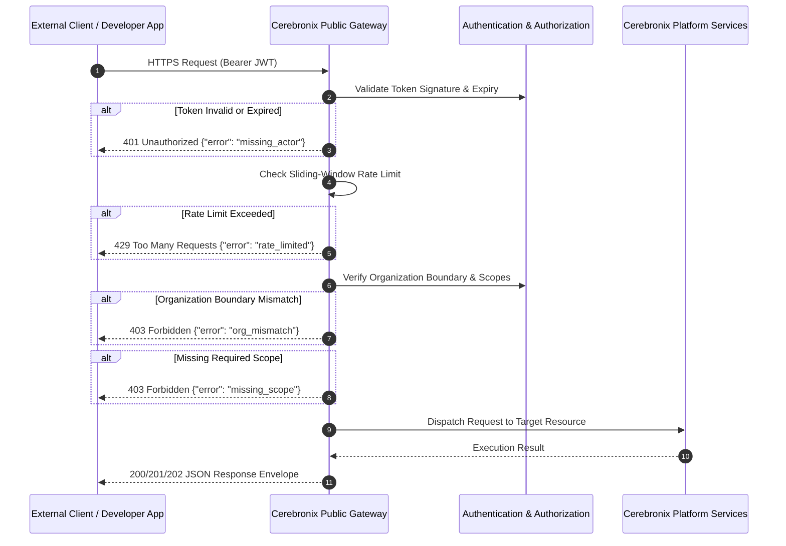

import { Callout } from "fumadocs-ui/components/callout";
import { Card, Cards } from "fumadocs-ui/components/card";
import { CrossLink } from "@cerebronix/docs-ui";

The Cerebronix Developer Platform provides programmatic, authenticated interfaces for integrating conversational AI agents, omnichannel communication pipelines, customer contact records, knowledge bases, and real-time messaging into third-party software architectures.

All public developer interactions are served exclusively through the official public gateway:

```http
https://public-api.cerebronix.com
```

<Callout type="warn">
  **Architectural Isolation Notice:** The Cerebronix Public API is strictly separated from the internal SaaS console session surface (`api.cerebronix.com`). Web browser session cookies, CSRF tokens, and internal GraphQL schemas are not valid public credentials and are strictly forbidden from third-party developer integrations.
</Callout>

---

## Public Developer Capabilities

The public interface exposes programmatic control across five foundational platform systems:

<Cards>
  <Card
    title="REST API"
    href="/docs/current/quickstart"
    description="Deterministic HTTPS/JSON endpoints for managing conversations, contacts, WhatsApp templates, and data sources."
  />
  <Card
    title="AI Agent Invocation"
    href="/docs/current/agents-and-ask"
    description="Direct RAG inference and knowledge querying via ask_agent, supporting synchronous and asynchronous execution."
  />
  <Card
    title="Model Context Protocol (MCP)"
    href="/docs/current/developer-mcp"
    description="HTTP POST JSON-RPC 2.0 server exposing 30 tools for Claude Desktop, Cursor, and autonomous AI agents."
  />
  <Card
    title="Real-Time WebSockets"
    href="/docs/current/webhooks-and-websockets"
    description="Full-duplex WebSocket channels for operator live-inbox supervision and embeddable website visitor sessions."
  />
  <Card
    title="Event Webhooks"
    href="/docs/current/webhooks-and-websockets"
    description="Outbound webhook delivery with HMAC-SHA256 signatures and anti-replay protection across 12 event types."
  />
  <Card
    title="Security & Isolation"
    href="/docs/current/security"
    description="Tenant isolation, cryptographically secured API keys, RS256 token exchange, and granular role-based access control (RBAC) scopes."
  />
</Cards>

---

## Architectural Topology & Request Flow

Every inbound request to `https://public-api.cerebronix.com` traverses edge security validation, cryptographic token verification, sliding-window rate limiting, and strict organization tenant boundary checks before reaching API domain services:



---

## Supported Protocols & Transports

| Protocol | Base URL / Path | Authentication Mechanism | Primary Use Case |
| :--- | :--- | :--- | :--- |
| **REST (HTTPS)** | `https://public-api.cerebronix.com/v1/...` | `Authorization: Bearer <access_token>` | CRUD operations, contacts, broadcast campaigns, data sources, billing. |
| **Token Exchange** | `POST https://public-api.cerebronix.com/v1/oauth/token` | HTTP Basic Auth or Form Credentials | Minting short-lived (1-hour) RS256 JWT access tokens from API keys. |
| **Public MCP** | `POST https://public-api.cerebronix.com/mcp` | `Authorization: Bearer <access_token>` (Scope: `mcp`) | JSON-RPC 2.0 tool execution for autonomous LLMs and developer IDEs. |
| **Operator WebSocket** | `wss://public-api.cerebronix.com/v1/ws/operator?ticket=...` | Single-use Operator Ticket (`POST /v1/organizations/{id}/ws_tickets`) | Real-time agent supervision, operator takeover, and live transcript streaming. |
| **Visitor WebSocket** | `wss://public-api.cerebronix.com/v1/ws/visitor?ticket=...` | Ephemeral Guest Session Token (`POST /v1/guest/sessions`) | Web chat widget integration without exposing organization API keys. |
| **Event Webhooks** | Outbound HTTP POST to developer URL | Header `Cerebronix-Signature: t=...,v1=...` (HMAC-SHA256) | Asynchronous notifications for message events, agent handoffs, and indexing. |

---

## Plan Tiers & Public API Entitlements

Access to the Cerebronix Public Developer Platform is governed by the organization's subscription tier. Organizations on Free Evaluation or Starter tiers cannot mint API keys or call public endpoints:

| Plan Tier | Public API Enabled? | General API RPM | `ask_agent` RPM | Max Campaign Recipients |
| :--- | :--- | :--- | :--- | :--- |
| **Free Evaluation** | <span className="text-red-500 font-semibold">Disabled</span> | 0 | 0 | 0 |
| **Starter** | <span className="text-red-500 font-semibold">Disabled</span> | 0 | 0 | 0 |
| **Growth** | <span className="text-emerald-500 font-semibold">Enabled</span> | 60 RPM | 20 RPM | 500 recipients / campaign |
| **Scale** | <span className="text-emerald-500 font-semibold">Enabled</span> | 300 RPM | 60 RPM | 2,000 recipients / campaign |
| **Enterprise** | <span className="text-emerald-500 font-semibold">Enabled</span> | Custom / Uncapped | Custom / Uncapped | Custom / Unlimited |

If an organization on Free or Starter attempts to execute a public API request, the platform returns:

```json
{
  "error": "public_api_disabled"
}
```

---

## Developer vs. Product Documentation

To maintain clarity and prevent confusion between operational dashboards and programmatic APIs, documentation is divided into two separate, dedicated properties:

- **Product Documentation ([docs.cerebronix.com](https://docs.cerebronix.com)):** Tailored for business operators, support leads, and store managers. Covers UI workflows, channel connection wizards, inbox triage, team roles, and billing invoices.
- **Developer Platform ([developer.cerebronix.com](https://developer.cerebronix.com)):** Tailored for software engineers and systems architects. Covers exact REST schemas, token lifecycles, SDK code samples, webhook replay protection, and MCP tool definitions.

---

## Integration Lifecycle Roadmap

1. **[Quickstart Guide](/docs/current/quickstart):** Mint your first API key, exchange it for an RS256 Bearer JWT, and execute your first authenticated request against `/v1/me`.
2. **[Authentication & Token Lifecycle](/docs/current/authentication):** Implement token caching, handle 1-hour expiration cycles, and review key rotation procedures.
3. **[Authorization, Roles & Scopes](/docs/current/authorization):** Configure granular, least-privilege scopes across the 19 grantable platform permissions.
4. **[Errors, Rate Limits & Retries](/docs/current/errors-rate-limits-audit):** Build robust backoff and jitter algorithms for handling sliding-window rate limits and transient errors.
5. **[Developer Security Best Practices](/docs/current/security):** Securely store credentials, implement tenant isolation safeguards, and verify outbound webhook signatures.

<CrossLink site="docs" path="/docs/getting-started/what-cerebronix-is">
  Read the Product Getting Started Guide
</CrossLink>
