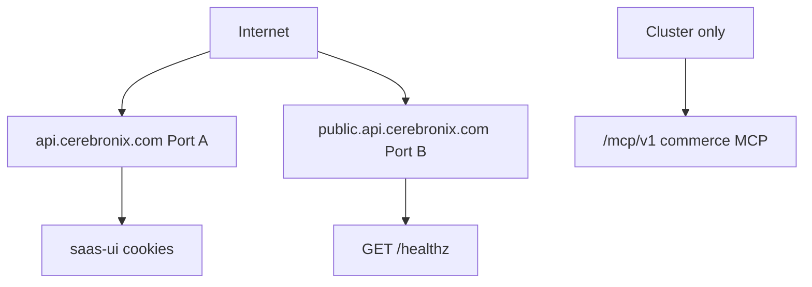

When you finish this page, you can name the four surfaces and know which one you are allowed to call.

Cerebronix has four HTTP surfaces. Do not treat them as one API.

| Surface | Host / port | Audience | What exists today |
|---|---|---|---|
| Session API (Port A) | `api.cerebronix.com`, local `:8000` | saas-ui, inbound provider webhooks | Cookie session. Not a public developer API. |
| Public listener (Port B) | `public.api.cerebronix.com`, local `:8010` | External developers (future) | `GET /healthz` only. |
| Commerce MCP | Cluster-only `/mcp/v1` | lexatronix | Never on public Ingress. No cart/checkout on the future public Developer MCP. |
| Future public REST | `public.api.cerebronix.com/v1/**` | Developers, ISVs | Designed. Not shipped. See platform preview. |

GraphQL is out of scope forever on this platform.

<WarnNever>
Do not call Port A, Chatwoot, or Lago as a developer integration. Do not publish the session OpenAPI. Do not use Kratos cookies as a machine credential.
</WarnNever>

<CrossLink site="docs" path="/docs/getting-started/what-cerebronix-is">Try the product UI</CrossLink>
