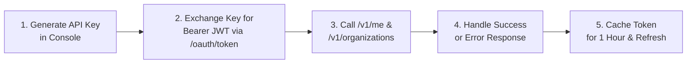

import { Step, Steps } from "fumadocs-ui/components/steps";
import { Tab, Tabs } from "fumadocs-ui/components/tabs";
import { Callout } from "fumadocs-ui/components/callout";

This guide walks you through generating an API key in the Cerebronix console, exchanging it for an OAuth 2.0 Bearer token, executing your first authenticated API request against `/v1/me`, and handling common response patterns.

<Callout type="info">
  **Prerequisites:** You must have an active **Growth**, **Scale**, or **Enterprise** organization account with an **Owner** or **Admin** role to create API keys. Free Evaluation and Starter tier organizations cannot mint public API credentials.
</Callout>

---

## The Integration Lifecycle



---

<Steps>

### Step 1: Obtain API Credentials

1. Sign in to your organization dashboard at [cerebronix.com](https://cerebronix.com).
2. In the left navigation, navigate to **Developer Settings** (`/developer`).
3. Click **Create API Key**.
4. Provide a descriptive label (e.g., `production-backend-service`).
5. Select the required role (`developer` or `viewer`) and grant the specific scopes your integration requires (e.g., `conversations:read`, `agents:read`).
6. Click **Generate Key**.

<Callout type="warn">
  **Save Your Secret Immediately:** Your API key consists of a **Key ID** (UUID) and a **Key Secret** (beginning with `cnx_live_`). The secret is displayed **only once** upon creation and cannot be retrieved later. Store it in a secure secrets manager.
</Callout>

---

### Step 2: Confirm Gateway Availability

Before executing authenticated requests, verify that your client environment can establish an encrypted HTTPS connection to the Cerebronix public edge:

```bash
curl -sS https://public-api.cerebronix.com/healthz
```

A healthy edge proxy returns:
```http
HTTP/1.1 200 OK
Content-Type: text/plain; charset=utf-8

ok
```

You can also inspect the public JSON Web Key Set (JWKS) used to verify token signatures:

```bash
curl -sS https://public-api.cerebronix.com/.well-known/jwks.json
```

---

### Step 3: Exchange the API Key for a Bearer Token

The Cerebronix Public API uses short-lived **RS256 JSON Web Tokens (JWTs)**. Third-party services authenticate by exchanging their API key via standard OAuth 2.0 `client_credentials` grant against `/v1/oauth/token`:

<Tabs items={["cURL", "TypeScript (Node.js)", "Python"]}>
```bash tab="cURL"
# Export credentials to environment
export CNX_KEY_ID="019234a5-6789-7abc-def0-123456789abc"
export CNX_KEY_SECRET="cnx_live_9f8e7d6c5b4a3210fedcba9876543210"

# Exchange credentials for a Bearer token
curl -sS -X POST https://public-api.cerebronix.com/v1/oauth/token \
  -u "$CNX_KEY_ID:$CNX_KEY_SECRET" \
  -H "Content-Type: application/x-www-form-urlencoded" \
  -d "grant_type=client_credentials"
```

```typescript tab="TypeScript (Node.js)"
import axios from 'axios';

interface TokenResponse {
  access_token: string;
  token_type: string;
  expires_in: number;
  scope: string;
}

async function getAccessToken(keyId: string, keySecret: string): Promise<string> {
  const credentials = Buffer.from(`${keyId}:${keySecret}`).toString('base64');
  
  const response = await axios.post<TokenResponse>(
    'https://public-api.cerebronix.com/v1/oauth/token',
    'grant_type=client_credentials',
    {
      headers: {
        'Authorization': `Basic ${credentials}`,
        'Content-Type': 'application/x-www-form-urlencoded',
      },
    }
  );

  return response.data.access_token;
}
```

```python tab="Python"
import os
import requests
from requests.auth import HTTPBasicAuth

def get_access_token(key_id: str, key_secret: str) -> str:
    url = "https://public-api.cerebronix.com/v1/oauth/token"
    payload = {"grant_type": "client_credentials"}
    
    response = requests.post(
        url,
        data=payload,
        auth=HTTPBasicAuth(key_id, key_secret),
        headers={"Content-Type": "application/x-www-form-urlencoded"}
    )
    response.raise_for_status()
    return response.json()["access_token"]
```
</Tabs>

#### Successful Token Response
```json
{
  "access_token": "eyJhbGciOiJSUzI1NiIsImtpZCI6IjY5YTY4NTV...",
  "token_type": "Bearer",
  "expires_in": 3600,
  "scope": "conversations:read conversations:write agents:read"
}
```

- `access_token`: Cryptographically signed RS256 JWT containing organization ID, actor identity, roles, and authorized scopes.
- `token_type`: Always `Bearer`.
- `expires_in`: Token lifespan in seconds (exactly `3600` seconds / 1 hour).
- `scope`: Space-delimited string of permissions assigned to this key.

---

### Step 4: Make Your First Authenticated Request

Pass the JWT in the `Authorization: Bearer <token>` header to query `/v1/me`, which verifies token validity and returns your actor profile:

<Tabs items={["cURL", "TypeScript (Node.js)", "Python"]}>
```bash tab="cURL"
curl -sS https://public-api.cerebronix.com/v1/me \
  -H "Authorization: Bearer $ACCESS_TOKEN"
```

```typescript tab="TypeScript (Node.js)"
async function inspectActor(token: string) {
  const response = await axios.get('https://public-api.cerebronix.com/v1/me', {
    headers: {
      Authorization: `Bearer ${token}`,
    },
  });
  console.log('Actor Profile:', response.data);
}
```

```python tab="Python"
def inspect_actor(token: str):
    response = requests.get(
        "https://public-api.cerebronix.com/v1/me",
        headers={"Authorization": f"Bearer {token}"}
    )
    response.raise_for_status()
    print("Actor Profile:", response.json())
```
</Tabs>

#### Expected Success Response (`200 OK`)
```json
{
  "actor_type": "api_key",
  "actor_id": "019234a5-6789-7abc-def0-123456789abc",
  "org_id": "67123456789abcdef0123456",
  "roles": [
    "developer"
  ],
  "scopes": [
    "conversations:read",
    "conversations:write",
    "agents:read"
  ]
}
```

Next, retrieve the authorized organizations your token is permitted to manage:

```bash
curl -sS https://public-api.cerebronix.com/v1/organizations \
  -H "Authorization: Bearer $ACCESS_TOKEN"
```

#### Response:
```json
{
  "organizations": [
    {
      "id": "67123456789abcdef0123456",
      "name": "Apex Retail Global"
    }
  ]
}
```

---

### Step 5: Understand Response Envelopes & Failure Modes

All Cerebronix public endpoints adhere to strict HTTP status codes and a uniform error envelope:

```json
{
  "error": "<error_code>"
}
```

#### Common Quickstart Error Cases

| HTTP Status | Error Code | Root Cause & Resolution |
| :--- | :--- | :--- |
| **`401 Unauthorized`** | `invalid_client` | The API Key ID or Secret provided in the token exchange is incorrect or has been revoked. |
| **`401 Unauthorized`** | `missing_actor` | The `Authorization: Bearer <token>` header was omitted, malformed, or the JWT expired. |
| **`403 Forbidden`** | `public_api_disabled` | Your organization is on the Free Evaluation or Starter plan. Upgrade to Growth or Scale in `/billing`. |
| **`403 Forbidden`** | `org_mismatch` | Tenant boundary violation. The `organization_id` specified in the URL path does not match the token's `org_id`. |
| **`403 Forbidden`** | `missing_scope` | The API key lacks the specific permission required for this route (e.g. calling `POST .../messages` without `conversations:write`). |
| **`429 Too Many Requests`** | `rate_limited` | Your client exceeded the plan-tier sliding-window RPM limit (60 RPM for Growth, 300 RPM for Scale). |

---

### Step 6: Production Best Practices

1. **Token Caching:** Access tokens are valid for **1 hour (3,600 seconds)**. Do not execute a token exchange before every API call. Cache the token in memory or a secure key-value store and renew it when 5 minutes of validity remain.
2. **Never Expose Secrets in Client Applications:** Public API keys are server-to-server credentials. Never embed them in mobile applications, frontend React components, or public web pages. For browser chat integrations, use the [Guest Session API](/docs/current/webhooks-and-websockets#guest-session-and-visitor-websocket).
3. **Use Idempotency Keys on Action Endpoints:** When invoking AI agents (`/ask`), supply a unique `Idempotency-Key: <uuid>` header to prevent duplicate execution during network retries.
4. **Exponential Backoff:** If you receive a `429 rate_limited` or `503 unavailable` response, retry using exponential backoff with randomized jitter (e.g., 1s, 2s, 4s, 8s).

</Steps>

---

## Next Steps

- Review the [Authentication & Token Lifecycle](/docs/current/authentication) specification.
- Learn about granular role enforcement in [Authorization & Scopes](/docs/current/authorization).
- Explore error handling patterns in [Errors, Rate Limits & Retries](/docs/current/errors-rate-limits-audit).
- Browse all endpoints in the [OpenAPI Specification](/docs/current/openapi).
