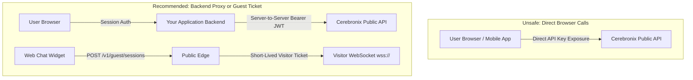

import { Callout } from "fumadocs-ui/components/callout";
import { Tab, Tabs } from "fumadocs-ui/components/tabs";

This guide establishes security guidelines and architectural patterns for developers integrating the Cerebronix Public Platform into production environments.

---

## 1. Secure Credential Management

API Key IDs and Secrets grant programmatic access to your organization's conversational data, contacts, and AI agents.

### Mandatory Storage Rules
- **Environment Variables & Secrets Managers:** Inject API credentials via environment variables (`CNX_KEY_ID`, `CNX_KEY_SECRET`) populated from dedicated secrets managers (AWS Secrets Manager, HashiCorp Vault, Google Secret Manager, Azure Key Vault).
- **Never Commit Credentials to Version Control:** Add `.env` and credential files to `.gitignore`. Use pre-commit hooks (such as `gitleaks` or `git-secrets`) to scan for keys matching the pattern `cnx_live_`.
- **Display Once Policy:** Cerebronix stores API secrets hashed using **Argon2id**. Once minted, the plain-text secret cannot be recovered from the dashboard.

---

## 2. Server-Side vs. Browser-Side Architecture

The Cerebronix Public API is strictly designed for **server-to-server** integration. 



<Callout type="error">
  **Never Embed API Keys in Client Bundles:** Do not reference API keys or execute `POST /v1/oauth/token` from single-page React/Vue applications, mobile apps, or client-side scripts. Doing so exposes your secret to anyone inspecting network traffic or decompiling the application bundle.
</Callout>

### Embedding Web Chat on Client Sites
If your goal is to embed a chat widget for website visitors, do not supply an API key. Instead:
1. Call `POST https://public-api.cerebronix.com/v1/guest/sessions` from your backend or authorized browser origin.
2. Receive an ephemeral, single-use visitor ticket.
3. Establish a WebSocket connection to `wss://public-api.cerebronix.com/v1/ws/visitor?ticket=<ticket>`.
4. This isolates visitor interactions completely from organization administrative credentials.

---

## 3. Principle of Least Privilege

When creating an API key, grant **only the minimum scopes** necessary for the integrating system:

| Integrating System | Recommended Role | Recommended Scopes | Excluded Scopes |
| :--- | :--- | :--- | :--- |
| **CRM Customer Sync** | `developer` | `contacts:read`, `contacts:write` | `conversations:*`, `billing:*`, `mcp` |
| **Support Operator Dashboard** | `developer` | `conversations:read`, `conversations:write` | `campaigns:*`, `datasources:*` |
| **Knowledge Ingestion Pipeline** | `developer` | `datasources:read`, `datasources:write` | `contacts:*`, `whatsapp:*` |
| **Finance & Billing Auditor** | `viewer` | `billing:read`, `analytics:read` | All `*:write` scopes |
| **AI Assistant / MCP Client** | `developer` | `mcp`, `agents:read`, `ask_agent` | `billing:*`, `webhooks:*` |

---

## 4. Tenant Boundary Integrity

Cerebronix enforces organization-level isolation across all public resources.

- Always parameterize the `{organization_id}` in your API clients to match your designated tenant organization.
- Never hardcode organization IDs across environments.
- Attempting to access an organization ID different from the token's `org_id` triggers an immediate `403 org_mismatch` security exception and is recorded in the platform security audit log.

---

## 5. Webhook Security & Signature Verification

Outbound webhooks sent by Cerebronix include an HMAC-SHA256 signature in the `Cerebronix-Signature` HTTP header:

```http
Cerebronix-Signature: t=1792394400,v1=5d41402abc4b2a76b9719d911017c592b23a9d7b4d...
```

### Verification Algorithm
To prevent spoofing and replay attacks:
1. **Extract Header Fields:** Parse the timestamp `t` and signature `v1`.
2. **Prevent Replay Attacks:** Compare `t` to current system time. Reject requests where `|now - t| > 300 seconds` (5 minutes).
3. **Compute HMAC:** Generate the HMAC-SHA256 hash using your subscription's webhook secret over the payload string:
   ```text
   expected_signature = HMAC-SHA256(secret, t + "." + raw_body)
   ```
4. **Constant-Time Comparison:** Use a constant-time comparison function (e.g. `crypto.timingSafeEqual`) to mitigate timing attacks.

<Tabs items={["TypeScript (Node.js)", "Python"]}>
```typescript tab="TypeScript (Node.js)"
import crypto from 'node:crypto';

export function verifyWebhookSignature(
  rawBody: Buffer | string,
  signatureHeader: string,
  webhookSecret: string,
  toleranceSeconds = 300
): boolean {
  // 1. Parse header parts
  const parts = signatureHeader.split(',');
  let timestamp = 0;
  let signatureHex = '';

  for (const part of parts) {
    const [k, v] = part.trim().split('=');
    if (k === 't') timestamp = parseInt(v, 10);
    if (k === 'v1') signatureHex = v;
  }

  if (!timestamp || !signatureHex) return false;

  // 2. Replay check (5-minute tolerance)
  const now = Math.floor(Date.now() / 1000);
  if (Math.abs(now - timestamp) > toleranceSeconds) {
    return false;
  }

  // 3. Compute expected HMAC
  const bodyString = typeof rawBody === 'string' ? rawBody : rawBody.toString('utf8');
  const payloadToSign = `${timestamp}.${bodyString}`;
  
  const hmac = crypto.createHmac('sha256', webhookSecret);
  hmac.update(payloadToSign);
  const expectedHex = hmac.digest('hex');

  // 4. Constant-time comparison
  const sigBuffer = Buffer.from(signatureHex, 'hex');
  const expectedBuffer = Buffer.from(expectedHex, 'hex');

  if (sigBuffer.length !== expectedBuffer.length) {
    return false;
  }

  return crypto.timingSafeEqual(sigBuffer, expectedBuffer);
}
```

```python tab="Python"
import time
import hmac
import hashlib

def verify_webhook_signature(
    raw_body: bytes,
    signature_header: str,
    webhook_secret: str,
    tolerance_seconds: int = 300
) -> bool:
    # 1. Parse header
    parts = dict(part.strip().split("=", 1) for part in signature_header.split(","))
    timestamp_str = parts.get("t")
    signature_hex = parts.get("v1")

    if not timestamp_str or not signature_hex:
        return False

    timestamp = int(timestamp_str)

    # 2. Replay check
    now = int(time.time())
    if abs(now - timestamp) > tolerance_seconds:
        return False

    # 3. Compute HMAC
    payload_to_sign = f"{timestamp}.".encode("utf-8") + raw_body
    expected_hex = hmac.new(
        webhook_secret.encode("utf-8"),
        payload_to_sign,
        hashlib.sha256
    ).hexdigest()

    # 4. Constant-time comparison
    return hmac.compare_digest(signature_hex, expected_hex)
```
</Tabs>

### SSRF Protection
The Cerebronix webhook dispatcher strictly validates delivery URLs before making requests:
- Only `https://` schemes are permitted (with local testing exception for `http://127.0.0.1` and `http://localhost`).
- Destination IP addresses are resolved. Private subnets (`10.0.0.0/8`, `172.16.0.0/12`, `192.168.0.0/16`), loopbacks, link-local addresses, and cloud instance metadata endpoints (`169.254.169.254`) are blocked.
- Ensure your webhook receivers reside on publicly routable hostnames with valid TLS certificates.

---

## 6. Safe Logging & Data Redaction

Ensure your logging infrastructure does not inadvertently record sensitive secrets or customer personal data:

- **Redact Authorization Headers:** Never log raw HTTP `Authorization` headers.
- **Redact API Secrets:** Mask strings matching `cnx_live_[A-Za-z0-9_]+`.
- **Redact Customer Identifiers:** Filter out phone numbers, email addresses, and customer payment details from debug and audit log streams.
