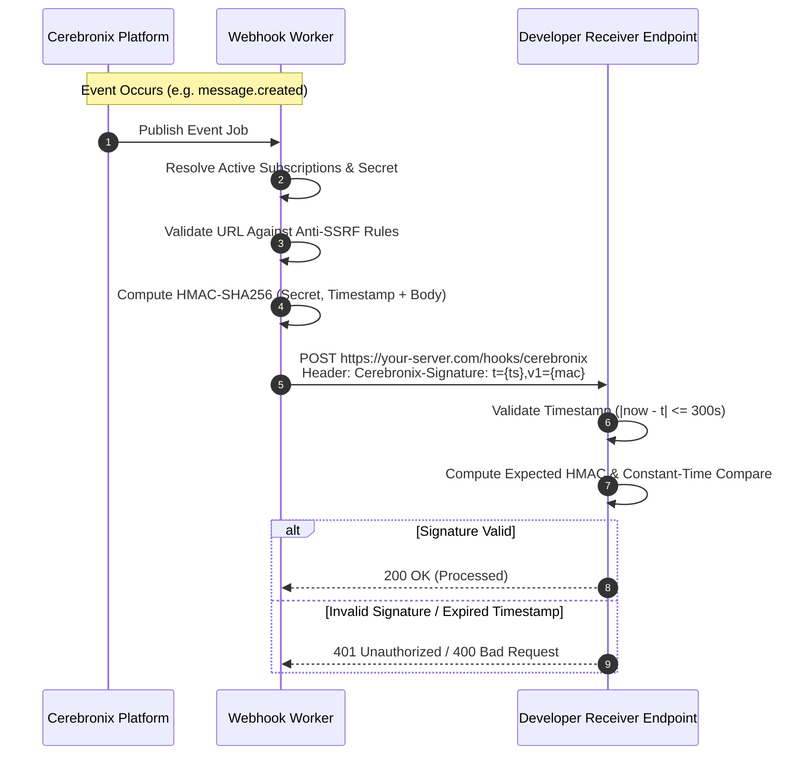

import { Callout } from "fumadocs-ui/components/callout";
import { Tab, Tabs } from "fumadocs-ui/components/tabs";

Cerebronix provides two complementary real-time communication systems for third-party systems:
1. **Outbound Webhooks:** HTTP POST notifications pushed to your server when asynchronous events occur (e.g., new messages, handoffs, indexing completions).
2. **Duplex WebSockets:** Persistent bidirectional streaming connections for operator live-inbox supervision (`/v1/ws/operator`) and embedded website visitor chat sessions (`/v1/ws/visitor`).

---

# Part 1: Event Webhooks

## Webhook Architecture & Security



---

## 1. Webhook Subscription Management

Manage webhook subscriptions programmatically via the REST API. Requires scope `webhooks:read` for inspection and `webhooks:write` for creation/updates.

### Create Webhook Subscription
```http
POST https://public-api.cerebronix.com/v1/organizations/{organization_id}/webhook_subscriptions
```

### Request Body
```json
{
  "url": "https://api.example.com/webhooks/cerebronix",
  "events": [
    "conversation.created",
    "conversation.handoff",
    "message.created",
    "campaign.completed"
  ]
}
```

<Tabs items={["cURL", "TypeScript", "Python"]}>
```bash tab="cURL"
curl -sS -X POST "https://public-api.cerebronix.com/v1/organizations/$ORG_ID/webhook_subscriptions" \
  -H "Authorization: Bearer $ACCESS_TOKEN" \
  -H "Content-Type: application/json" \
  -d '{
    "url": "https://api.example.com/webhooks/cerebronix",
    "events": ["conversation.created", "message.created"]
  }'
```

```typescript tab="TypeScript"
async function createWebhook(orgId: string, url: string, events: string[], token: string) {
  const response = await axios.post(
    `https://public-api.cerebronix.com/v1/organizations/${orgId}/webhook_subscriptions`,
    { url, events },
    {
      headers: {
        Authorization: `Bearer ${token}`,
        'Content-Type': 'application/json',
      },
    }
  );
  return response.data;
}
```

```python tab="Python"
def create_webhook(org_id: str, url: str, events: list, token: str):
    endpoint = f"https://public-api.cerebronix.com/v1/organizations/{org_id}/webhook_subscriptions"
    headers = {"Authorization": f"Bearer {token}", "Content-Type": "application/json"}
    payload = {"url": url, "events": events}
    response = requests.post(endpoint, headers=headers, json=payload)
    response.raise_for_status()
    return response.json()
```
</Tabs>

#### Response (`201 Created`)
```json
{
  "subscription": {
    "id": "whk_01923456789a",
    "url": "https://api.example.com/webhooks/cerebronix",
    "events": [
      "conversation.created",
      "message.created"
    ],
    "disabled": false,
    "created_at": "2026-10-19T22:40:00Z",
    "updated_at": "2026-10-19T22:40:00Z"
  },
  "secret": "9a8b7c6d5e4f3a2b1c0d9e8f7a6b5c4d3e2f1a0b9c8d7e6f"
}
```

<Callout type="warn">
  **Store the Webhook Secret Immediately:** The 48-character hex secret is returned in plain text **only upon subscription creation** or secret rotation. Store this secret to verify signatures on incoming deliveries.
</Callout>

---

### Rotate Webhook Secret
If a webhook secret is compromised, generate a new signing secret without recreating the subscription:

```http
POST https://public-api.cerebronix.com/v1/organizations/{organization_id}/webhook_subscriptions/{id}/rotate_secret
```

#### Response (`200 OK`)
```json
{
  "secret": "1f2e3d4c5b6a7f8e9d0c1b2a3f4e5d6c7b8a9f0e1d2c3b4a"
}
```

---

## 2. The 12 Supported Webhook Event Types

Cerebronix dispatches webhooks across 12 discrete platform event types:

| Event Name | Category | Trigger Condition |
| :--- | :--- | :--- |
| **`conversation.created`** | Messaging | A customer initiates a new conversation thread across any channel. |
| **`conversation.resolved`** | Messaging | A conversation is resolved by an operator or automated agent workflow. |
| **`conversation.handoff`** | Messaging | An inquiry is escalated to a human supervisor (`pending_human`). |
| **`message.created`** | Messaging | An incoming customer message or outgoing operator/agent message is posted. |
| **`whatsapp.template.sent`** | Outreach | An outbound Meta HSM template message is successfully sent to Meta's servers. |
| **`whatsapp.template.failed`** | Outreach | A template dispatch failed (e.g. invalid phone number, unconsented contact). |
| **`campaign.completed`** | Outreach | An outbound broadcast campaign finishes processing all recipient contacts. |
| **`ask_agent.completed`** | AI Engine | An asynchronous `ask_agent` RAG inference job completes generation. |
| **`agent.created`** | AI Engine | A new AI agent configuration is published. |
| **`agent.updated`** | AI Engine | System prompt instructions, model settings, or channel bindings are updated. |
| **`channel.updated`** | Channels | Channel status, health status, or agent binding transitions. |
| **`datasource.indexed`** | Knowledge | A document, website crawl, or text data source completes vector indexing. |

---

## 3. Webhook Delivery Payload Schema

Outbound deliveries use standard JSON payloads containing metadata and an event-specific `data` object:

```json
{
  "id": "evt_01923456789b",
  "type": "message.created",
  "created_at": "2026-10-19T22:42:00Z",
  "organization_id": "67123456789abcdef0123456",
  "data": {
    "conversation_id": "67123456789abcdef0123456",
    "message_id": "msg_01923456789c",
    "direction": "incoming",
    "content": "Can you check if order #10842 has shipped?",
    "sender_type": "contact"
  }
}
```

---

## 4. Cryptographic Signature Verification (`Cerebronix-Signature`)

Every webhook HTTP request includes the custom header:

```http
Cerebronix-Signature: t=1792394520,v1=5d41402abc4b2a76b9719d911017c592b23a9d7b4d852a4e2bd9
```

- `t`: Unix timestamp (seconds) when the delivery attempt was signed.
- `v1`: Hex-encoded HMAC-SHA256 signature calculated over `${t}.${raw_request_body}`.

### Verification Implementation

<Tabs items={["Node.js (TypeScript)", "Python"]}>
```typescript tab="Node.js (TypeScript)"
import crypto from 'node:crypto';

export function verifyCerebronixSignature(
  rawBody: Buffer | string,
  signatureHeader: string,
  secret: string,
  toleranceSeconds = 300
): boolean {
  const parts = signatureHeader.split(',');
  let timestamp = 0;
  let signatureHex = '';

  for (const part of parts) {
    const [key, value] = part.trim().split('=');
    if (key === 't') timestamp = parseInt(value, 10);
    if (key === 'v1') signatureHex = value;
  }

  if (!timestamp || !signatureHex) return false;

  // 1. Replay attack check (5-minute tolerance)
  const now = Math.floor(Date.now() / 1000);
  if (Math.abs(now - timestamp) > toleranceSeconds) {
    return false;
  }

  // 2. Compute HMAC over t.body
  const bodyPayload = typeof rawBody === 'string' ? rawBody : rawBody.toString('utf8');
  const payloadToSign = `${timestamp}.${bodyPayload}`;

  const hmac = crypto.createHmac('sha256', secret);
  hmac.update(payloadToSign);
  const expectedHex = hmac.digest('hex');

  // 3. Constant-time comparison
  const sigBuf = Buffer.from(signatureHex, 'hex');
  const expBuf = Buffer.from(expectedHex, 'hex');

  if (sigBuf.length !== expBuf.length) return false;
  return crypto.timingSafeEqual(sigBuf, expBuf);
}
```

```python tab="Python"
import time
import hmac
import hashlib

def verify_cerebronix_signature(
    raw_body: bytes,
    signature_header: str,
    secret: str,
    tolerance_seconds: int = 300
) -> bool:
    parts = dict(part.strip().split("=", 1) for part in signature_header.split(","))
    timestamp_str = parts.get("t")
    signature_hex = parts.get("v1")

    if not timestamp_str or not signature_hex:
        return False

    timestamp = int(timestamp_str)

    # 1. Replay check
    now = int(time.time())
    if abs(now - timestamp) > tolerance_seconds:
        return False

    # 2. Compute expected HMAC
    payload = f"{timestamp}.".encode("utf-8") + raw_body
    expected_hex = hmac.new(
        secret.encode("utf-8"),
        payload,
        hashlib.sha256
    ).hexdigest()

    # 3. Constant-time comparison
    return hmac.compare_digest(signature_hex, expected_hex)
```
</Tabs>

---

## 5. Delivery Retries & Anti-SSRF Protections

- **Timeout:** Cerebronix enforces a **10-second timeout** on webhook delivery attempts. Receivers must respond with HTTP `2xx` promptly. Heavy processing should be deferred to an internal worker queue.
- **Redirects:** The dispatcher **does not follow HTTP redirects** (`301`, `302`, `308`). Delivery to a redirect responds as a delivery failure.
- **Auto-Disabling Circuit Breaker:** If an endpoint fails **5 consecutive delivery attempts**, the subscription is automatically disabled (`disabled: true`). To resume delivery, update the subscription or reset its status via `PATCH`.
- **SSRF Restrictions:** The webhook engine validates destination IP addresses prior to dispatch. Delivery to loopbacks (`127.0.0.1`), private RFC1918 subnets (`10.0.0.0/8`, `172.16.0.0/12`, `192.168.0.0/16`), link-local IPs, or AWS/GCP cloud metadata (`169.254.169.254`) is strictly blocked.

---

# Part 2: WebSocket APIs

## Operator WebSocket API (`/v1/ws/operator`)

The Operator WebSocket provides an authenticated real-time stream of all organization conversation events, enabling custom support dashboards to display live transcripts, monitor queue states, and manage operator takeovers without polling.

### Step 1: Mint an Operator Ticket
Operator WebSocket connections require a single-use ticket minted via REST:

```http
POST https://public-api.cerebronix.com/v1/organizations/{organization_id}/ws_tickets
```

```bash
curl -sS -X POST "https://public-api.cerebronix.com/v1/organizations/$ORG_ID/ws_tickets" \
  -H "Authorization: Bearer $ACCESS_TOKEN"
```

#### Response (`200 OK`)
```json
{
  "ticket": "eyJhbGciOiJSUzI1NiIsImtpZCI6IjY5YTY4NTV...",
  "expires_in": 120
}
```

<Callout type="info">
  **Ticket Lifetime:** Operator tickets are valid for **120 seconds (2 minutes)** and are **single-use**. If consumed or expired, the gateway rejects connection upgrade with `401 ticket_used` or `401 invalid_ticket`.
</Callout>

### Step 2: Establish the WebSocket Connection

Connect to the operator stream passing the ticket in the query parameter:

```http
wss://public-api.cerebronix.com/v1/ws/operator?ticket={ticket}
```

#### Connection Handshake Frame
Upon connection, the server immediately sends a connection confirmation event:

```json
{
  "type": "connected",
  "id": "ws_actor_01923456789a",
  "created_at": "2026-10-19T22:45:00Z",
  "data": {
    "org_id": "67123456789abcdef0123456"
  }
}
```

#### Heartbeats & Ping/Pong
The server emits standard WebSocket `Ping` control frames every **30 seconds**. Client libraries (such as browser `WebSocket` or Node.js `ws`) automatically reply with `Pong` frames. If no pong is received within 5 seconds, the connection is terminated.

#### Real-Time Event Stream
The operator socket streams real-time `PublicEvent` payloads identically structured to webhooks:

```json
{
  "id": "evt_01923456789c",
  "type": "message.created",
  "created_at": "2026-10-19T22:45:10Z",
  "organization_id": "67123456789abcdef0123456",
  "data": {
    "conversation_id": "67123456789abcdef0123456",
    "direction": "incoming",
    "content": "Can I cancel my subscription?",
    "sender_type": "contact"
  }
}
```

---

## Visitor WebSocket API (`/v1/ws/visitor`)

The Visitor WebSocket allows web chat widgets to establish real-time chat sessions on customer websites without exposing administrative organization API keys.

### Step 1: Mint a Guest Session Token

From your website backend or front-end widget, request an ephemeral guest ticket:

```http
POST https://public-api.cerebronix.com/v1/guest/sessions
```

### Request Body
```json
{
  "organization_id": "67123456789abcdef0123456",
  "channel_id": "670123456789abcdef012345",
  "visitor_ref": "anon_visitor_9841"
}
```

#### Response (`200 OK`)
```json
{
  "ticket": "eyJhbGciOiJSUzI1NiIsImtpZCI6IjY5YTY4NTV...",
  "expires_in": 3600
}
```

- **Origin Filtering:** Guest ticket minting enforces browser `Origin` header validation against allowlisted customer domains and `*.cerebronix.com`. Unauthorized origins receive `403 origin_not_allowed`.
- **Abuse Prevention:** Rate-limited to 60 requests/minute per client IP and 1,200 requests/minute per organization.

### Step 2: Connect to Visitor Chat

```http
wss://public-api.cerebronix.com/v1/ws/visitor?ticket={guest_ticket}
```

#### Initial Connection Frame
```json
{
  "event": "session_init",
  "data": {
    "userId": "anon_visitor_9841",
    "orgId": "67123456789abcdef0123456"
  }
}
```

#### Sending Visitor Messages
```json
{
  "event": "message",
  "data": {
    "text": "What are your return policy terms?",
    "conversation_id": "67123456789abcdef0123456"
  }
}
```

#### Receiving AI Agent / Operator Replies
```json
{
  "event": "bot_reply",
  "data": {
    "text": "We offer a 30-day money-back guarantee on all unopened items.",
    "conversation_id": "67123456789abcdef0123456"
  }
}
```
