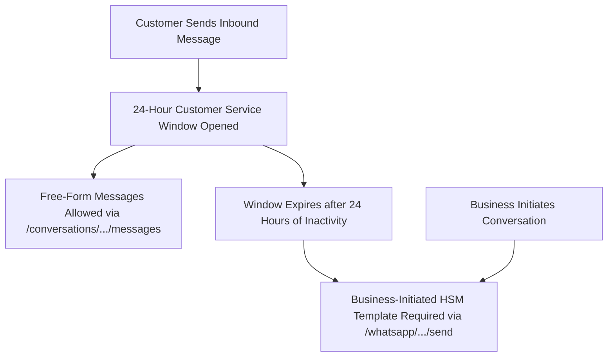

import { Callout } from "fumadocs-ui/components/callout";
import { Tab, Tabs } from "fumadocs-ui/components/tabs";

The Cerebronix WhatsApp & Campaigns API provides programmatic access to Meta-approved Highly Structured Message (HSM) templates and outbound broadcast campaign execution across customer contact segments.

All requests are org-scoped and versioned under `https://public-api.cerebronix.com/v1/organizations/{organization_id}`.

---

## Service Window vs. Business-Initiated Templates

WhatsApp Business API enforces strict conversation category policies established by Meta:



1. **Customer Service Messages (24-Hour Window):** When a customer sends an inbound message, a 24-hour customer service window opens. During this window, you can exchange free-form text messages via the standard [Conversations API](/docs/current/conversations#4-send-message-operator--outgoing).
2. **Business-Initiated Messages:** Outside the 24-hour window, or when initiating outbound communication, you **must strictly use a pre-approved Meta HSM template**. Free-form messages outside the 24-hour window are rejected by Meta.

---

## Required Permissions & Scopes

| Endpoint | HTTP Method | Required Scope | Minimum Role |
| :--- | :--- | :--- | :--- |
| `/v1/organizations/{org_id}/whatsapp/templates` | `GET` | `whatsapp:send` | `developer` |
| `/v1/organizations/{org_id}/whatsapp/templates/{name}/send` | `POST` | `whatsapp:send` | `developer` |
| `/v1/organizations/{org_id}/campaigns` | `POST` | `campaigns:write` | `developer` |
| `/v1/organizations/{org_id}/campaigns/{id}` | `GET` | `campaigns:write` | `developer` |

---

## 1. List Approved WhatsApp Templates

Retrieve all pre-approved templates synchronized from your Meta WhatsApp Business Account:

```http
GET https://public-api.cerebronix.com/v1/organizations/{organization_id}/whatsapp/templates
```

```bash
curl -sS "https://public-api.cerebronix.com/v1/organizations/$ORG_ID/whatsapp/templates" \
  -H "Authorization: Bearer $ACCESS_TOKEN"
```

#### Response (`200 OK`)
```json
{
  "templates": [
    {
      "name": "order_shipping_update",
      "category": "UTILITY",
      "status": "APPROVED",
      "languages": ["en", "es"],
      "components": [
        {
          "type": "BODY",
          "text": "Hello {{1}}, your order #{{2}} has shipped! Tracking number: {{3}}."
        }
      ]
    },
    {
      "name": "holiday_flash_sale",
      "category": "MARKETING",
      "status": "APPROVED",
      "languages": ["en"],
      "components": [
        {
          "type": "BODY",
          "text": "Hi {{1}}, get 20% off all audio accessories this weekend with code {{2}}."
        }
      ]
    }
  ]
}
```

---

## 2. Send Individual Template Message

Dispatch an approved HSM template directly to a single customer phone number or contact ID:

```http
POST https://public-api.cerebronix.com/v1/organizations/{organization_id}/whatsapp/templates/{name}/send
```

### Request Parameters
- `name` (path parameter): The exact template name registered with Meta (e.g., `order_shipping_update`).
- `to_phone` (string): The recipient's E.164 phone number (e.g., `+12065550199`).
- `to_contact_id` (string, optional): The Cerebronix contact record ID (resolves phone automatically).
- `language` (string): ISO language code matching an approved translation (default `en`).
- `components` (array): Array of dynamic parameter substitutions matching template variables (`{{1}}`, `{{2}}`).

<Tabs items={["cURL", "TypeScript", "Python"]}>
```bash tab="cURL"
curl -sS -X POST "https://public-api.cerebronix.com/v1/organizations/$ORG_ID/whatsapp/templates/order_shipping_update/send" \
  -H "Authorization: Bearer $ACCESS_TOKEN" \
  -H "Content-Type: application/json" \
  -d '{
    "to_phone": "+12065550199",
    "language": "en",
    "components": [
      {
        "type": "body",
        "parameters": [
          {"type": "text", "text": "Alex"},
          {"type": "text", "text": "10842"},
          {"type": "text", "text": "FEDEX-982347"}
        ]
      }
    ]
  }'
```

```typescript tab="TypeScript"
async function sendWhatsAppTemplate(orgId: string, templateName: string, phone: string, variables: string[], token: string) {
  const payload = {
    to_phone: phone,
    language: 'en',
    components: [
      {
        type: 'body',
        parameters: variables.map(text => ({ type: 'text', text })),
      },
    ],
  };

  const response = await axios.post(
    `https://public-api.cerebronix.com/v1/organizations/${orgId}/whatsapp/templates/${templateName}/send`,
    payload,
    {
      headers: {
        Authorization: `Bearer ${token}`,
        'Content-Type': 'application/json',
      },
    }
  );
  return response.data;
}
```

```python tab="Python"
def send_whatsapp_template(org_id: str, template_name: str, phone: str, variables: list, token: str):
    url = f"https://public-api.cerebronix.com/v1/organizations/{org_id}/whatsapp/templates/{template_name}/send"
    payload = {
        "to_phone": phone,
        "language": "en",
        "components": [
            {
                "type": "body",
                "parameters": [{"type": "text", "text": var} for var in variables]
            }
        ]
    }
    headers = {"Authorization": f"Bearer {token}", "Content-Type": "application/json"}
    response = requests.post(url, headers=headers, json=payload)
    response.raise_for_status()
    return response.json()
```
</Tabs>

#### Response (`200 OK`)
```json
{
  "message_id": "wamid.HBgLMTE...",
  "status": "sent"
}
```

---

## 3. Create Outbound Broadcast Campaign

Broadcast an approved template to an entire contact group or targeted list of contact IDs:

```http
POST https://public-api.cerebronix.com/v1/organizations/{organization_id}/campaigns
```

### Request Body
```json
{
  "template_name": "holiday_flash_sale",
  "language": "en",
  "group_id": "grp_019234567890"
}
```

```bash
curl -sS -X POST "https://public-api.cerebronix.com/v1/organizations/$ORG_ID/campaigns" \
  -H "Authorization: Bearer $ACCESS_TOKEN" \
  -H "Content-Type: application/json" \
  -d '{
    "template_name": "holiday_flash_sale",
    "language": "en",
    "group_id": "grp_019234567890"
  }'
```

#### Response (`201 Created`)
```json
{
  "id": "cmp_01923456789a",
  "template_name": "holiday_flash_sale",
  "language": "en",
  "group_id": "grp_019234567890",
  "status": "queued",
  "recipient_count": 342,
  "sent_count": 0,
  "failed_count": 0,
  "skipped_count": 0,
  "created_at": "2026-10-19T22:30:00Z",
  "updated_at": "2026-10-19T22:30:00Z"
}
```

---

## 4. Track Campaign Progress

Poll campaign delivery status and aggregate delivery counters:

```http
GET https://public-api.cerebronix.com/v1/organizations/{organization_id}/campaigns/{id}
```

#### Response (`200 OK`)
```json
{
  "id": "cmp_01923456789a",
  "template_name": "holiday_flash_sale",
  "group_id": "grp_019234567890",
  "status": "completed",
  "recipient_count": 342,
  "sent_count": 338,
  "failed_count": 2,
  "skipped_count": 2,
  "created_at": "2026-10-19T22:30:00Z",
  "updated_at": "2026-10-19T22:34:15Z"
}
```

---

## Plan Recipient Caps & Entitlements

Outbound campaign batch sizes are bounded by the organization's subscription tier:

| Plan Tier | Max Recipients per Campaign | Enforcement Failure Code |
| :--- | :--- | :--- |
| **Growth Plan** | **500 recipients** | `403 recipient_cap` |
| **Scale Plan** | **2,000 recipients** | `403 recipient_cap` |
| **Enterprise Plan** | **Custom / Unlimited** | N/A |

If the resolved recipient count of a group exceeds your plan's cap, the campaign is rejected immediately with:

```json
{
  "error": "recipient_cap"
}
```

---

## Compliance, Consent & Opt-Out Enforcement

Cerebronix enforces strict Meta WhatsApp Business Policy compliance before dispatching messages:

1. **WhatsApp Opt-In Enforcement:** Before sending any marketing template, the recipient record must have documented customer consent (`marketing_opt_in: true`). Attempting to dispatch a marketing template to unconsented contacts returns:
   ```json
   {
     "error": "marketing_opt_in_required"
   }
   ```
2. **Opt-Out Handling:** If a contact has messaged `STOP` or unsubscribed, their record is flagged. Subsequent template dispatches are blocked and return:
   ```json
   {
     "error": "opted_out"
   }
   ```
3. **Missing Phone Number:** If a contact record lacks an E.164 phone number, dispatch returns:
   ```json
   {
     "error": "no_phone"
   }
   ```
